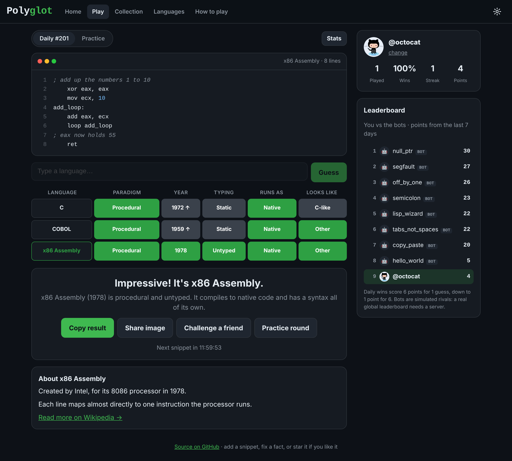

# Polyglot

[](https://github.com/1amaaaal/polygot/actions/workflows/test.yml)

**The daily guess-the-programming-language game.** Every day there's a new code snippet,
and you get six guesses to name the language.

**[▶ Play it here](https://1amaaaal.github.io/polygot/)**



## How it works

- You start with **3 lines** of code. Each wrong guess reveals **2 more**.
- Every guess is compared with the answer on five clues:

| Clue | Example values |
|---|---|
| **Paradigm** | Functional, Object-oriented, Procedural, Logic… |
| **Year** | When it first appeared. 🟨 means within 5 years, and the arrow points to the answer |
| **Typing** | Static, Dynamic, Untyped |
| **Runs as** | Native, VM, Interpreted, JIT, Transpiled |
| **Looks like** | C-like, Lisp, ML-like, Shell… |

- When you're done, share a spoiler-free result:

```
Polyglot #12 3/6

⬛🟨⬛🟩🟩
🟩⬛⬛🟩🟩
🟩🟩🟩🟩🟩
```

There are **35 languages**, from Python and Rust to COBOL, Prolog and x86 Assembly. The daily
puzzles are kept on the server, so their answers can't be read from the page or this
repository; the arcade plays the 80 public snippets in `data/snippets.txt`.

## Features

The site has four sections, so the extras stay out of the way of the daily puzzle:

- **Today**: the daily puzzle, the same for everyone. Hard mode switches off syntax colours
  and makes every guess fit the clues so far.
- **Arcade**: endless mode (random snippets until you miss one), a 60-second speed run,
  practice rounds and the archive of past puzzles.
- **Leaderboard**: weekly boards for the daily puzzle, the speed run and endless mode. Sign in
  with GitHub to appear on them. While there are only a few players, the boards are topped up
  with bots, and they're labelled as bots.
- **Profile**: sign in with GitHub, your stats, 18 badges, the languages you've collected, and
  Polyglot Wrapped, a short year-in-review you can share.

Every answer comes with who created the language, a fact about it and a link to read more
(spot a mistake? every fact has a "report it" link). Results can be shared as an emoji grid,
an image card or a challenge link to the same snippet. The arcade works offline, it installs
as an app, and it has a colour-blind mode, light and dark themes, and keyboard and
screen-reader support.

Signing in is optional. Without it, your progress stays in your browser. With it, your progress
syncs between devices, and the server saves your daily guesses as you play and puts your
result on the leaderboard.

## Pages

| Page | What's there |
|---|---|
| `index.html` | Home |
| `play.html` | The game: daily, archive (`?day=`), challenge (`?c=`), practice and endless (`?mode=`) |
| `speed.html` | The speed run |
| `arcade.html` | The extra modes and the archive |
| `leaderboard.html` | This week's boards |
| `profile.html` | Stats, badges and the collection |
| `wrapped.html` | Polyglot Wrapped |
| `languages.html` | All 35 languages with their traits and facts, searchable |
| `help.html` | How to play |

## Run it locally

No build step and no dependencies: it's plain HTML, CSS and JavaScript.

```bash
git clone https://github.com/1amaaaal/polygot.git
cd polygot
npm start            # or: python3 -m http.server 8000
# open http://localhost:8000
```

## Tests

```bash
npm test                                     # game logic and snippet checks (Node 20+)

PGHOST=localhost PGUSER=postgres npm run test:db   # supabase/schema.sql on a real Postgres

npm install --no-save playwright             # end-to-end test in a real browser
npx playwright install chromium
node tests/e2e/play.mjs http://localhost:8000/
```

The unit tests also check every snippet: that it names a known language, has 5 to 14
lines, and doesn't spell out its own language name. The database tests run the schema on
Postgres with a stand-in for Supabase's roles, and check who can read and write what and
every path through `play_daily()`. The end-to-end test uses a stand-in for the server
(`tests/e2e/fake-server.mjs`) that follows the same rules.

## Contributing

The easiest way to help is to **add a snippet**. It's a few lines in a text file, with no
code changes needed. See [CONTRIBUTING.md](CONTRIBUTING.md).

## How the daily puzzle works

The daily puzzles and their answers live in a private table on the server. The page never
downloads them. It sends your guesses to `play_daily()` (in `supabase/schema.sql`), which
checks them and sends back only what you've earned: the lines you may see, the length of the
hidden ones, the clues for each guess, and the answer once the puzzle is over. So there is
nothing to find with Inspect Element, the Network tab or this repository.

If you're signed in, the server also saves each guess as you make it. Guesses can only be
added to, never replaced, and the server writes your result to the leaderboard itself; the
browser can't send results any more. What this can't stop is someone playing a second
time, signed out, to see the answer first. That costs them a whole game, like asking a
friend.

The puzzles are added with `tools/seed.mjs` from a private file kept outside the repository
(see the comments in that file). Each day has one puzzle, and the same language never comes
twice in a row. The arcade boards (speed run and endless) still trust the browser, because
the arcade snippets are public anyway.

The leaderboard bots' results come from a seeded random generator
(`src/leaderboard.js`), so every visitor sees the same standings. Badges are defined in
`src/achievements.js`, each as a target for one number worked out from your saved progress.

The interface uses [IBM Plex](https://github.com/IBM/plex) (SIL Open Font License), served
from `fonts/`.

## The server

The daily puzzle, accounts, leaderboards and syncing use a [Supabase](https://supabase.com)
project. The site talks to it directly from the browser (`src/server.js`); what each visitor
may read and write is enforced by the database itself, set up in `supabase/schema.sql`. The
arcade works without it, offline included.

To run your own copy:

1. Create a Supabase project. In its SQL editor, run `supabase/schema.sql`, then
   `supabase/languages.sql`, then your daily puzzles: write snippets in the format of
   `data/snippets.txt` into `private/daily-snippets.txt` (ignored by git) and run
   `node tools/seed.mjs daily private/daily-snippets.txt --start 0 > private/daily-puzzles.sql`.
2. Create a GitHub OAuth app whose callback URL is your project's
   `https://<project>.supabase.co/auth/v1/callback`, and turn on the GitHub provider in
   Supabase with its client ID and secret.
3. Add your site's address to Supabase's redirect URLs.
4. Put your project URL and publishable key at the top of `src/server.js`.

## License

[MIT](LICENSE)
